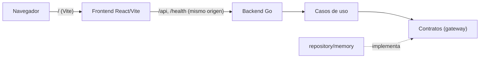
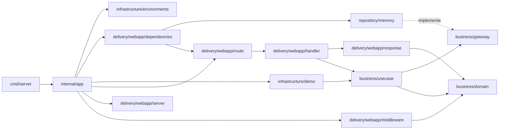

# Arquitectura y estructura

Market aplica los principios útiles de Clean Architecture —límites claros,
dependencias hacia el negocio, adaptadores reemplazables— sin capas que
todavía no aporten. Las reglas obligatorias están en
[AGENTS.md](../AGENTS.md); la estructura objetivo completa, en
[plans/version-base.md §3](plans/version-base.md#3-arquitectura). Acá se
documenta lo que **existe hoy** y las decisiones vigentes.

## Vista general



## Backend

```text
apps/backend/
├── cmd/server/main.go                     # señales + app.New(ctx).Run(ctx)
└── internal/
    ├── app/app.go                         # composition root: config, contenedor, datos demo, rutas, servidor
    ├── business/
    │   ├── domain/                        # Error, Actor, Money, Quantity, Percent, Page, StatusFilter, Category…
    │   ├── gateway/                       # TxManager, Clock, CategoryRepository
    │   │   └── gatewayfake/               # fakes de los contratos para tests de casos de uso
    │   └── usecase/categories/            # create, list, get, update, deactivate, reactivate
    └── infrastructure/
        ├── environments/config.go         # PORT, STORAGE_DRIVER, CORS_ALLOWED_ORIGIN, SEED_DEMO_DATA
        ├── clock/system.go                # reloj real (UTC)
        ├── demo/seed.go                   # datos demo, cargados a través de los casos de uso
        ├── repository/
        │   ├── memory/                    # Store + TxManager + un repositorio por agregado
        │   └── repositorytest/            # suite de contrato compartida por todos los adaptadores
        └── delivery/webapp/
            ├── dependencies/              # IoC: repositorios → casos de uso → handlers
            ├── dto/                       # health, pagination (PageResponse[T]), categories
            ├── handler/                   # un handler por ruta + Adapt, decodeJSON, pageQuery
            ├── middleware/                # DevActor, Recover, RequestLog
            ├── response/                  # WriteJSON, WriteError (único mapeo Kind → status)
            ├── route/                     # rutas, timeouts y route.Handlers
            └── server/                    # http.Server y CORS opcional
```

Cadena de middlewares (de afuera hacia adentro): `RequestLog` → `Recover` →
`WithCORS` (solo si hay `CORS_ALLOWED_ORIGIN`) → `DevActor` → mux.

### Dirección de dependencias



- Un handler no ejecuta lógica de negocio ni accede a la persistencia.
- Un repositorio no toma decisiones de negocio.
- Un caso de uso no conoce `http.Request`, JSON, `sync.Mutex` ni `pgx`.
- `dependencies` arma el grafo y elige el adaptador según `STORAGE_DRIVER`.
  `Container.Handlers()` devuelve el `route.Handlers` ya armado: construye
  objetos, pero no registra rutas (eso lo hace `internal/app`).
- Los datos demo (`SEED_DEMO_DATA`, activo por defecto) pasan por los mismos
  casos de uso que la app, así que respetan sus reglas.

### Convenciones HTTP

- Endpoints de negocio bajo `/api/v1`; JSON en `camelCase` e inglés.
- Errores: `{ "code": "…", "message": "…" }`. Cualquier ruta o método bajo
  `/api/` que no exista responde `404 route_not_found` con ese mismo formato
  (también un método no soportado: se prefiere un único formato de error al
  405 en texto plano del mux).
- Listados: `?q=&status=active|inactive|all&page=&limit=` →
  `{ "items": [], "total": 0, "page": 1, "limit": 25 }` (`PageResponse[T]`).
  `items` nunca es `null`.
- Bajas lógicas: `DELETE` desactiva y responde la entidad;
  `POST /{id}/reactivate` la reactiva. Pedir el estado que ya tiene no es
  error.
- `PATCH` parcial: un campo ausente o `null` no cambia; un texto opcional
  vacío lo borra.
- `Adapt(h, timeout)` acota el contexto al timeout de la ruta y el cuerpo a
  1 MiB (`handler.MaxBodyBytes`). Los deadlines del `http.Server` derivan del
  mayor timeout registrado (`route.MaxHandlerTimeout`).
- `GET /health/live` responde `{ "status": "ok" }`. `/health/ready` (con
  chequeo de la base) llega con PostgreSQL.

### Persistencia en memoria

`memory.Store` guarda todas las tablas detrás de un único `sync.Mutex`:

- `WithinTx(ctx, fn)` toma el lock durante toda la unidad de trabajo, así que
  las transacciones son serializables. Un `ctx` que ya está dentro de una
  transacción del mismo store se une a ella en vez de bloquearse.
- Cada escritura (`put`, `remove`) registra cómo deshacerse. Si `fn` devuelve
  error o entra en pánico, los pasos se deshacen en orden inverso y las
  tablas quedan exactamente como estaban.
- Las tablas guardan valores, y los repositorios copian los punteros y
  slices que guardan o devuelven (por ejemplo `cloneCategory`), para que
  nadie mute una tabla fuera del lock.
- Las restricciones que en PostgreSQL serían índices (como el nombre único
  entre categorías activas) las verifica el repositorio dentro del lock, y la
  suite de contrato prueba que se cumplan también bajo concurrencia.
- Los IDs son UUIDv7, ordenados por tiempo como los de `uuidv7()` en
  PostgreSQL 18.

Se eligió un registro de deshacer en lugar de copiar todo el estado en cada
transacción (como proponía el plan): cuesta lo mismo que las escrituras
hechas, no lo que mide la base completa.

## Frontend

```text
apps/frontend/src/
├── app/                      # composición: router, layout, navegación, tema, providers
│   ├── router.tsx            # Inicio, /categorias y página 404
│   ├── AppLayout.tsx         # sidebar (escritorio) + header + barra inferior (celular)
│   ├── navigation.ts         # secciones del menú; cada fase suma la suya
│   ├── ServerStatus.tsx      # estado del backend (GET /health/live cada 30 s)
│   ├── ThemeProvider.tsx     # claro / oscuro / automático, guardado en localStorage
│   └── Providers.tsx         # QueryClient + tema + toasts
├── features/
│   ├── dashboard/pages/DashboardPage.tsx
│   └── categories/           # api/, hooks/, components/, pages/, types.ts
├── shared/
│   ├── api/                  # apiFetch + ApiError (Zod), pagination, query-keys, health
│   ├── config/env.ts         # VITE_API_URL opcional
│   ├── hooks/                # useDebouncedValue
│   ├── lib/utils.ts          # cn
│   └── ui/                   # primitivos shadcn/Base UI + kit de ABM (ver abajo)
├── test/                     # setup de Vitest y renderWithProviders
├── index.css                 # tokens de tema claro/oscuro (oklch)
└── main.tsx
```

- `app → features → shared`; una feature no importa a otra.
- `apiFetch(path, schema, options)` valida cada respuesta con un esquema Zod:
  si el contrato con el backend se desalinea, falla con `invalid_response`
  en vez de renderizar valores indefinidos.
- Estado del servidor con TanStack Query; claves en `shared/api/query-keys.ts`.
  Los listados usan `keepPreviousData` para no parpadear al buscar o
  paginar, y cada mutación invalida la clave raíz de su entidad.

### Kit de ABM (`shared/ui`)

| Componente | Para qué |
| --- | --- |
| `PageHeader` | Título, descripción y acción principal de la pantalla. |
| `SearchField` | Búsqueda con ícono y botón para limpiar; se combina con `useDebouncedValue`. |
| `StatusFilter` | Activos / Inactivos / Todos (las etiquetas concuerdan en género con la entidad). |
| `ResponsiveList` | Tabla desde `md:` y tarjetas en el celular; skeleton mientras carga. |
| `Pagination` | “1–25 de 40” + Anterior / Siguiente. |
| `FormSheet` | Panel lateral en escritorio, pantalla completa en el celular. |
| `ConfirmDialog` | Confirmación de acciones destructivas (`role="alertdialog"`). |
| `EmptyState` | Vacío, sin resultados o error, siempre con una salida. |
| `ToastProvider` / `useToast` | Avisos de éxito o error (Toast de Base UI, sin dependencias extra). |
| `Field`, `Input`, `Textarea` | Campos con label, ayuda y error; 44 px de alto en el celular. |

## Receta de ABM

Los pasos que siguió categorías y que repite cada entidad nueva (artículos,
clientes, proveedores, vendedores).

**Backend**

1. `domain/<entidad>.go`: entidad, constructor `New…` que valida, cambios
   parciales (`…Changes` + `Apply`), `WithActive`, errores `*domain.Error`
   con mensajes en español y tests de tabla. Si la entidad necesita permisos
   nuevos, se agregan a la matriz de `domain/permission.go` y a su test.
2. `gateway/<entidad>_repository.go`: contrato (`Create`, `Get`, `Update`,
   `List` con filtro y página) documentando qué errores devuelve.
3. `gateway/gatewayfake/`: fake que registra llamadas y devuelve lo
   configurado.
4. `usecase/<feature>/`: un archivo por caso de uso (`Execute`) que pide su
   permiso con `Actor.Authorize(domain.Permission…)` (nunca un rol) y
   traduce los errores del adaptador con `domain.FromStorage`.
5. `repository/repositorytest/<entidad>.go`: la suite de contrato (unicidad,
   no encontrado, filtros, orden, paginado, copias, concurrencia).
6. `repository/memory/<entidad>.go`: el adaptador, con su test que corre la
   suite.
7. `dto/<feature>/`: requests, response y conversión desde el dominio.
8. `handler/`: un handler por ruta, con tests de su contrato HTTP.
9. `route.Handlers` + `RegisterRoutes`, `dependencies`, datos demo y el
   paquete nuevo en `test:backend:coverage:profile`.

**Frontend**

1. `features/<feature>/types.ts`: esquemas Zod de la respuesta y del
   formulario, y el mapa de códigos de error del backend a campos.
2. `api/`: una función por endpoint con `apiFetch` y su esquema.
3. `hooks/`: `use<Entidades>` (listado) y las mutaciones que invalidan la
   clave de la entidad.
4. `components/`: formulario (validación con Zod + errores del backend en el
   campo correspondiente), listado sobre `ResponsiveList`.
5. `pages/<Entidades>Page.tsx`: compone el kit (búsqueda, filtro, listado,
   paginación, `FormSheet`, `ConfirmDialog`, toasts).
6. Ruta en `app/router.tsx` y sección en `app/navigation.ts`.
7. Tests de la página contra una API falsa en memoria que respeta las mismas
   reglas que el backend (ver `CategoriesPage.test.tsx`).

### Tema y diseño

- Tokens en `index.css` (`--primary`, `--success`, `--warning`, …) con
  variantes clara y oscura; la regla ESLint `local/no-raw-tailwind-colors`
  prohíbe colores crudos de Tailwind.
- Tipografía Inter (variable, servida desde el propio bundle: la CSP no
  permite fuentes externas).
- El tema se aplica antes del primer render para evitar el destello claro.

### Seguridad

La CSP se inyecta en build con un `<meta>` desde
`vite-plugins/content-security-policy.ts`: `connect-src 'self'` (más el
origen exacto de `VITE_API_URL` si se define), scripts solo propios y
`'unsafe-inline'` en estilos únicamente en desarrollo.

## Decisiones vigentes

- **Mismo origen para frontend y API**: proxy de Vite en desarrollo; en
  producción, reverse proxy o el binario Go sirviendo el build. CORS solo con
  `CORS_ALLOWED_ORIGIN`.
- **Unidad de trabajo explícita** (`gateway.TxManager`): la atomicidad no la
  decide cada repositorio.
- **Registro de deshacer** en el store en memoria (ver arriba).
- **Sin autenticación todavía**; los casos de uso igual reciben un `Actor`.
- **Go 1.27** desde el inicio (LoteosAPP sigue en 1.26).
