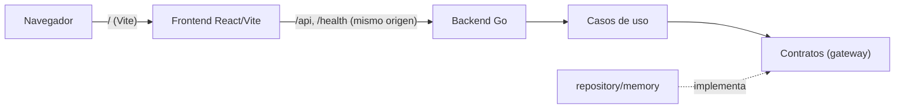
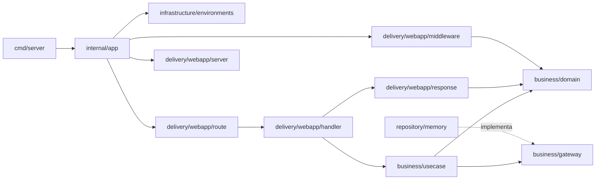

# Arquitectura y estructura

Market aplica los principios útiles de Clean Architecture —límites claros,
dependencias hacia el negocio, adaptadores reemplazables— sin capas que
todavía no aporten. Las reglas obligatorias están en
[AGENTS.md](../AGENTS.md); la estructura objetivo completa, en
[plans/version-base.md §3](plans/version-base.md#3-arquitectura). Acá se
documenta lo que **existe hoy** y las decisiones vigentes.

## Vista general



## Backend

```text
apps/backend/
├── cmd/server/main.go                     # señales + app.New().Run(ctx)
└── internal/
    ├── app/app.go                         # composition root y ciclo de vida
    ├── business/
    │   ├── domain/                        # Error, Actor, Money, Quantity, Percent, Page, NormalizeText
    │   └── gateway/tx_manager.go          # TxManager (unidad de trabajo)
    └── infrastructure/
        ├── environments/config.go         # PORT, STORAGE_DRIVER, CORS_ALLOWED_ORIGIN
        ├── repository/memory/store.go     # Store + TxManager en memoria
        └── delivery/webapp/
            ├── dto/health/                # package dto
            ├── handler/                   # HTTPHandler, Adapt, decodeJSON, Live, NotFound
            ├── middleware/                # DevActor, Recover, RequestLog
            ├── response/                  # WriteJSON, WriteError (único mapeo Kind → status)
            ├── route/                     # rutas y MaxHandlerTimeout
            └── server/                    # http.Server y CORS opcional
```

Cadena de middlewares (de afuera hacia adentro): `RequestLog` → `Recover` →
`WithCORS` (solo si hay `CORS_ALLOWED_ORIGIN`) → `DevActor` → mux.

### Dirección de dependencias



- Un handler no ejecuta lógica de negocio ni accede a la persistencia.
- Un repositorio no toma decisiones de negocio.
- Un caso de uso no conoce `http.Request`, JSON, `sync.Mutex` ni `pgx`.
- `dependencies` (IoC) aparece con la primera feature (Fase 1) y elige el
  adaptador según `STORAGE_DRIVER`.

### Convenciones HTTP

- Endpoints de negocio bajo `/api/v1`; JSON en `camelCase` e inglés.
- Errores: `{ "code": "…", "message": "…" }`. Cualquier ruta bajo `/api/`
  que no exista responde `404 route_not_found` con ese mismo formato.
- `Adapt(h, timeout)` acota el contexto al timeout de la ruta y el cuerpo a
  1 MiB (`handler.MaxBodyBytes`). Los deadlines del `http.Server` derivan del
  mayor timeout registrado (`route.MaxHandlerTimeout`).
- `GET /health/live` responde `{ "status": "ok" }`. `/health/ready` (con
  chequeo de la base) llega con PostgreSQL.

### Persistencia en memoria

`memory.Store` guarda todas las tablas detrás de un único `sync.Mutex`:

- `WithinTx(ctx, fn)` toma el lock durante toda la unidad de trabajo, así que
  las transacciones son serializables. Un `ctx` que ya está dentro de una
  transacción del mismo store se une a ella en vez de bloquearse.
- Cada escritura (`put`, `remove`) registra cómo deshacerse. Si `fn` devuelve
  error o entra en pánico, los pasos se deshacen en orden inverso y las
  tablas quedan exactamente como estaban.
- Las tablas guardan valores, nunca punteros, y los repositorios copian los
  slices que guardan o devuelven, para que nadie mute una tabla fuera del
  lock.

Se eligió un registro de deshacer en lugar de copiar todo el estado en cada
transacción (como proponía el plan): cuesta lo mismo que las escrituras
hechas, no lo que mide la base completa.

## Frontend

```text
apps/frontend/src/
├── app/                      # composición: router, layout, navegación, tema, providers
│   ├── router.tsx            # rutas (Inicio + página 404)
│   ├── AppLayout.tsx         # sidebar (escritorio) + header + barra inferior (celular)
│   ├── navigation.ts         # secciones del menú; cada fase suma la suya
│   ├── ServerStatus.tsx      # estado del backend (GET /health/live cada 30 s)
│   ├── ThemeProvider.tsx     # claro / oscuro / automático, guardado en localStorage
│   └── Providers.tsx         # QueryClient + tema
├── features/
│   └── dashboard/pages/DashboardPage.tsx
├── shared/
│   ├── api/                  # apiFetch + ApiError (valida con Zod), query-keys, health
│   ├── config/env.ts         # VITE_API_URL opcional
│   ├── lib/utils.ts          # cn
│   └── ui/                   # button (shadcn/Base UI), PageHeader, EmptyState
├── index.css                 # tokens de tema claro/oscuro (oklch)
└── main.tsx
```

- `app → features → shared`; una feature no importa a otra.
- `apiFetch(path, schema, options)` valida cada respuesta con un esquema Zod:
  si el contrato con el backend se desalinea, falla con `invalid_response`
  en vez de renderizar valores indefinidos.
- Estado del servidor con TanStack Query; claves en `shared/api/query-keys.ts`.
- Los componentes del patrón ABM (`ResponsiveList`, `FormSheet`,
  `ConfirmDialog`, `SearchField`) se crean en la Fase 1 con su primer uso
  real, el ABM de categorías.

### Tema y diseño

- Tokens en `index.css` (`--primary`, `--success`, `--warning`, …) con
  variantes clara y oscura; la regla ESLint `local/no-raw-tailwind-colors`
  prohíbe colores crudos de Tailwind.
- Tipografía Inter (variable, servida desde el propio bundle: la CSP no
  permite fuentes externas).
- El tema se aplica antes del primer render para evitar el destello claro.

### Seguridad

La CSP se inyecta en build con un `<meta>` desde
`vite-plugins/content-security-policy.ts`: `connect-src 'self'` (más el
origen exacto de `VITE_API_URL` si se define), scripts solo propios y
`'unsafe-inline'` en estilos únicamente en desarrollo.

## Decisiones vigentes

- **Mismo origen para frontend y API**: proxy de Vite en desarrollo; en
  producción, reverse proxy o el binario Go sirviendo el build. CORS solo con
  `CORS_ALLOWED_ORIGIN`.
- **Unidad de trabajo explícita** (`gateway.TxManager`): la atomicidad no la
  decide cada repositorio.
- **Registro de deshacer** en el store en memoria (ver arriba).
- **Sin autenticación todavía**; los casos de uso igual reciben un `Actor`.
- **Go 1.27** desde el inicio (LoteosAPP sigue en 1.26).
