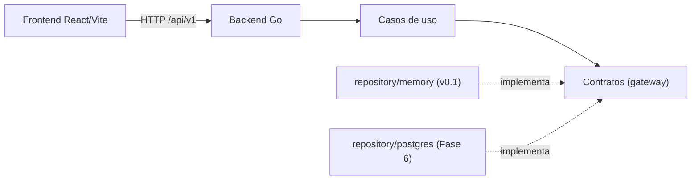
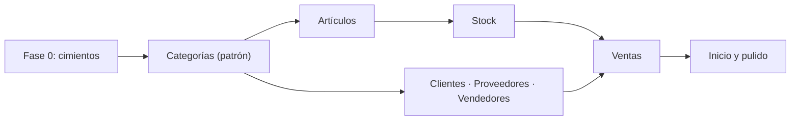

# Plan: Punto de Venta — versión base (v0.1)

Fecha: 2026-11-10 · Estado: propuesta · Referencia: [LoteoApp/LoteosAPP](https://github.com/LoteoApp/LoteosAPP)

## 1. Objetivo y alcance

Construir la base de un sistema de punto de venta (POS) como monorepo
React + Vite + Go (+ PostgreSQL más adelante), con la misma infraestructura y
reglas de trabajo que LoteosAPP. La versión base tiene que:

- dejar cerrada y probada la **lógica core** del negocio: catálogo, terceros,
  stock y ventas;
- persistir **en memoria** en el backend, detrás de contratos que después
  implementa PostgreSQL sin tocar dominio ni casos de uso;
- no comprometerse todavía con un **hosting** (local o nube) ni con un
  proveedor de **autenticación**;
- tener una **interfaz amigable, simple y moderna**, usable desde el celular y
  pensada para cobrar rápido en el mostrador.

Nombre del proyecto: **Market** (punto de venta). Módulo Go `market/backend`,
paquete `@market/frontend`.

### Incluye (v0.1)

- ABM de **categorías, artículos, clientes, proveedores y vendedores**.
- **Stock**: existencias por artículo, ingreso de mercadería, ajustes,
  historial de movimientos y alerta de stock bajo.
- **Ventas**: pantalla de cobro (POS), varios medios de pago, descuentos,
  vuelto, listado, detalle, anulación con reversión de stock y ticket
  imprimible (no fiscal).
- **Inicio**: ventas del día y artículos con stock bajo.
- **Datos demo** cargados al iniciar (la memoria se pierde al reiniciar).

### Queda afuera (ver §10)

PostgreSQL, autenticación y usuarios, caja (apertura/cierre), compras y
cuentas corrientes, listas de precios y promociones, facturación electrónica
ARCA, multi-sucursal, reportes y modo offline.

## 2. Qué tomamos de LoteosAPP

| Práctica | Se adopta |
| --- | --- |
| Monorepo pnpm: `apps/backend`, `apps/frontend`, `docs/`, `migrations/` | Igual. `migrations/` recién aparece con PostgreSQL. |
| `AGENTS.md` como fuente de verdad; `CLAUDE.md` solo apunta a él | Igual (ya redactado en este repo). |
| Backend por capa técnica: `internal/business/{domain,gateway,usecase}` e `internal/infrastructure/...` | Igual. |
| Caso de uso = interfaz de un solo método `Execute` + implementación, en un archivo, subpaquete por feature | Igual. |
| Un handler por ruta con un único caso de uso; `HTTPHandler` + `Adapt(h, timeout)`; `decodeJSON[T]` | Igual. |
| Errores de negocio `*domain.Error{Kind, Code, Message, Cause}`; `response.WriteError` es el único mapeo a HTTP | Igual. |
| DTOs en `delivery/webapp/dto/<feature>` con `package dto` | Igual. |
| IoC en `dependencies`; `internal/app` es composition root y dueño del ciclo de vida | Igual; además elige el adaptador de persistencia según configuración. |
| Fakes de contratos en `gateway/gatewayfake` | Igual. |
| `Idempotency-Key` en altas críticas (la venta) con hash del payload | Igual. |
| Configuración por variables de entorno que reporta **todas** las faltantes juntas | Igual. |
| Timeouts por ruta y deadlines del `http.Server` derivados del mayor | Igual. |
| Frontend por feature: `app → features → shared`; una feature no importa a otra | Igual. |
| Mobile-first; shadcn/ui + Tailwind con tokens; regla ESLint `no-raw-tailwind-colors` | Igual. |
| CSP inyectada por un plugin de Vite | Igual. |
| Tests: stdlib `testing` + `httptest`; Vitest + RTL + user-event; tests junto al código | Igual. |
| Cobertura 80 % líneas/sentencias/funciones, 75 % ramas, 90 % en reglas críticas; `scripts/check-go-coverage.mjs` | Igual. |
| CI: build, test, coverage, dependency-audit, dependency-review, compose-config, main-source-branch | Igual (sin servicio PostgreSQL hasta que exista). |
| Conventional Commits simplificados, plantilla de PR, ramas `main`/`develop`/`hotfix/*` | Igual. |
| Comentarios solo cuando el comportamiento no es obvio; el “por qué” va a `docs/` o al PR | Igual. |
| `.gitattributes` con LF, `.gitignore`, `.env.example`, `.claude/launch.json` | Igual. |

### Dónde nos apartamos, y por qué

1. **Inglés en todo lo que no ve el usuario**: código, rutas, campos JSON y,
   más adelante, tablas. LoteosAPP mezcla (`razonSocial`, `/inmobiliarias`,
   `domain.Cliente`) y anotó la unificación como deuda. Un proyecto nuevo
   arranca parejo. Español solo en textos de UI y en el `Message` de los
   errores. El glosario ES ↔ EN vive en `docs/domain.md`.
2. **Unidad de trabajo explícita (`gateway.TxManager`)**. En LoteosAPP la
   atomicidad vive dentro de cada repositorio (`SaleRepository.Create` abre la
   transacción y llama a la máquina de estados). En un POS una venta toca
   artículos, stock, movimientos y la venta misma (y después caja y cuenta
   corriente): si cada repositorio abre su transacción, la regla de stock
   termina escrita en SQL. Con `WithinTx(ctx, fn)` la regla queda en el
   dominio y cada adaptador (memoria hoy, PostgreSQL mañana) resuelve la
   atomicidad.
3. **TanStack Query desde el inicio**. LoteosAPP lo posterga “hasta que haya
   caché, invalidación, mutaciones o datos compartidos entre pantallas”. El POS
   cumple esa condición desde el día uno: artículos, clientes y vendedores los
   usan el ABM, el stock y la pantalla de cobro, y cada venta invalida stock e
   inicio.
4. **Zod para respuestas y formularios**. LoteosAPP valida la forma de cada
   respuesta con type guards escritos a mano (`isClientResponse`). Con ocho
   entidades, un esquema por tipo da validación en runtime y tipo de TypeScript
   desde una sola fuente.
5. **El frontend llama a `/api` relativo** (proxy de Vite en desarrollo) en
   lugar de `VITE_API_URL` + CORS. Funciona igual si mañana el binario Go sirve
   el frontend (instalación local) o si un reverse proxy publica ambos bajo el
   mismo dominio (nube). `VITE_API_URL` queda como override opcional y CORS
   solo se activa si se configura un origen distinto.
6. **Sin autenticación todavía, pero con actor**. Los casos de uso ya reciben
   un `Actor` (id + rol) y validan permisos; un middleware de desarrollo
   inyecta un actor fijo. Cuando se elija proveedor (depende del hosting) se
   reemplaza el middleware, no los casos de uso.

## 3. Arquitectura

### Vista general



### Backend

Estructura objetivo (los directorios se crean recién cuando tienen contenido):

```text
apps/backend/
├── cmd/server/main.go
├── internal/
│   ├── app/app.go                    # composition root + ciclo de vida
│   ├── business/
│   │   ├── domain/
│   │   │   ├── error.go              # Error{Kind, Code, Message, Cause}, igual a LoteosAPP
│   │   │   ├── actor.go              # Actor, Role y permisos
│   │   │   ├── money.go              # Money en centavos (int64)
│   │   │   ├── quantity.go           # Quantity en milésimas (int64) + Unit
│   │   │   ├── page.go               # PageRequest / Page[T]
│   │   │   ├── text.go               # normalización para búsqueda y unicidad
│   │   │   ├── category.go
│   │   │   ├── item.go
│   │   │   ├── customer.go
│   │   │   ├── supplier.go
│   │   │   ├── seller.go
│   │   │   ├── stock.go              # StockLevel, StockMovement, StockPolicy
│   │   │   └── sale.go               # Sale, SaleLine, Payment, cálculo y anulación
│   │   ├── gateway/
│   │   │   ├── tx_manager.go         # WithinTx(ctx, fn)
│   │   │   ├── <entidad>_repository.go
│   │   │   └── gatewayfake/          # un fake por contrato
│   │   └── usecase/
│   │       ├── categories/  items/  customers/  suppliers/  sellers/
│   │       ├── stock/                # existencias, movimientos, ingreso, ajuste
│   │       ├── sales/                # alta, listado, detalle, anulación
│   │       └── dashboard/            # resumen de inicio
│   └── infrastructure/
│       ├── environments/config.go
│       ├── repository/
│       │   ├── memory/               # Store + TxManager + un archivo por repositorio + seed.go
│       │   └── repositorytest/       # suite de contrato: memoria hoy, PostgreSQL mañana
│       └── delivery/webapp/
│           ├── dependencies/         # IoC; elige memory/postgres según STORAGE_DRIVER
│           ├── dto/<feature>/        # package dto
│           ├── handler/              # un handler por ruta + Adapt + decodeJSON
│           ├── middleware/           # actor de desarrollo, log de requests, recover
│           ├── response/             # WriteJSON, WriteError (único mapeo Kind → status)
│           ├── route/                # registro de rutas y timeouts
│           └── server/               # http.Server y CORS opcional
├── Dockerfile.dev
└── go.mod
```

Dirección de dependencias: idéntica a LoteosAPP. `domain` no importa nada del
proyecto; `gateway` importa `domain`; `usecase` importa `gateway` y `domain`;
los adaptadores de `infrastructure` importan e implementan los contratos.
Ningún caso de uso conoce `http.Request`, JSON, `sync.Mutex` ni tipos de `pgx`.

### Persistencia en memoria, lista para PostgreSQL

- **Contratos** en `business/gateway`: un repositorio por agregado, más
  `TxManager`. Toda operación de I/O recibe `context.Context`.
- **`repository/memory`**: un único `Store` con todas las “tablas” (maps) y un
  `sync.Mutex`. `WithinTx` toma el lock y ejecuta `fn`; cada escritura
  registra cómo deshacerse y, si `fn` devuelve error, se deshacen en orden
  inverso. Da las mismas garantías que una transacción serializable. Los
  repositorios toman el lock por su cuenta salvo que el `ctx` ya esté dentro
  de una transacción. *(Implementado en la Fase 0 con registro de deshacer en
  lugar de copiar todo el estado: ver `docs/architecture.md`.)*
- **PostgreSQL (Fase 6)**: `WithinTx` abre un `pgx.Tx` y lo guarda en el
  `ctx`; los repositorios usan esa transacción o el pool. Las lecturas de
  stock dentro de una venta usan `SELECT … FOR UPDATE`.
- **Identificadores**: los asigna el repositorio (UUIDv7; en PostgreSQL 18,
  `DEFAULT uuidv7()`). El número de venta es correlativo (contador en memoria,
  secuencia en PostgreSQL).
- **Suite de contrato (`repositorytest`)**: recibe un constructor de
  repositorios y verifica alta, búsqueda, eliminación, unicidad de código
  y barras, rollback de transacción y concurrencia de stock. Corre hoy contra
  memoria y mañana contra PostgreSQL sin cambios: así el reemplazo se puede
  verificar en vez de suponer.
- **Selección**: `STORAGE_DRIVER=memory` (default). `postgres` llega en Fase 6.
- **Datos demo**: `SEED_DEMO_DATA=true` (default en desarrollo) carga
  categorías, artículos con stock, clientes, proveedores y vendedores.

### Convenciones HTTP

- Endpoints bajo `/api/v1`, JSON en `camelCase` y en inglés.
- Errores `{ "code": "insufficient_stock", "message": "No hay stock suficiente de Yerba 1 kg" }`.
- Listados paginados: `?q=&page=&limit=` →
  `{ "items": [...], "total": 120, "page": 1, "limit": 25 }`; `limit` máximo 100.
- `PATCH` parcial: un campo ausente no cambia.
- ABM = alta, edición y eliminación (sin activar/desactivar). `DELETE`
  borra y responde `204`; si otro registro lo referencia, `409`
  `<entidad>_in_use`.
- `POST /api/v1/sales` exige `Idempotency-Key`.
- Salud: `GET /health/live` (Fase 0) y `GET /health/ready`, que chequea la
  base y llega con PostgreSQL.

### Endpoints de la versión base

| Recurso | Endpoints |
| --- | --- |
| Categorías | `GET` `POST /api/v1/categories` · `GET` `PATCH` `DELETE /api/v1/categories/{id}` |
| Artículos | Mismo patrón en `/api/v1/items` (`?q=&categoryId=&lowStock=`) · `GET /api/v1/items/lookup?code=` (código o barras exacto, para el lector) |
| Clientes | Mismo patrón en `/api/v1/customers` |
| Proveedores | Mismo patrón en `/api/v1/suppliers` |
| Vendedores | Mismo patrón en `/api/v1/sellers` |
| Stock | `GET /api/v1/stock` (`?q=&lowStock=true`) · `GET /api/v1/stock/movements` (`?itemId=&type=&from=&to=`) · `POST /api/v1/stock/entries` · `POST /api/v1/stock/adjustments` |
| Ventas | `POST /api/v1/sales` · `GET /api/v1/sales` (`?from=&to=&sellerId=&customerId=&status=`) · `GET /api/v1/sales/{id}` · `POST /api/v1/sales/{id}/void` |
| Inicio | `GET /api/v1/dashboard/summary` |

### Frontend

```text
apps/frontend/src/
├── app/
│   ├── router.tsx
│   ├── providers.tsx          # QueryClient, tema, Toaster
│   ├── AppLayout.tsx          # sidebar + header + contenido; barra inferior en celular
│   ├── Sidebar.tsx  MobileNav.tsx  CommandMenu.tsx
│   ├── PosRoute.tsx           # compone pos con artículos, clientes, vendedores y ventas
│   └── <Pantalla>Route.tsx    # composición entre features
├── features/
│   ├── dashboard/  pos/  sales/  items/  categories/
│   ├── stock/  customers/  suppliers/  sellers/
│   │   └── api/ components/ hooks/ lib/ pages/ types.ts   # types.ts: esquemas Zod + tipos inferidos
├── shared/
│   ├── api/                   # client.ts (apiFetch, ApiError), pagination.ts, query-keys.ts
│   ├── config/env.ts
│   ├── ui/                    # shadcn + PageHeader, EmptyState, ResponsiveList, ConfirmDialog,
│   │                          #   FormSheet, SearchField, MoneyInput, QuantityInput
│   ├── lib/                   # cn, formatMoney, formatQuantity, formatDate, normalizeText, idempotencyKey
│   └── hooks/                 # useDebouncedValue, useHotkeys
├── index.css                  # tokens de tema claro/oscuro
└── main.tsx
```

- `app → features → shared`. Una feature no importa archivos de otra; la
  composición ocurre en `app` (props o render props, como `SaleForm` en
  LoteosAPP).
- Si dos o más features necesitan la **misma lectura** (por ejemplo, buscar
  artículos desde el POS y desde el ingreso de stock), su cliente HTTP vive en
  `shared/api`, como `shared/api/agencies.ts` en LoteosAPP.
- Estado del servidor en TanStack Query con claves centralizadas
  (`shared/api/query-keys.ts`); estado visual cerca del componente; Context
  solo para lo transversal (tema). Sin store global.
- Importes en centavos también en el frontend; `formatMoney` usa
  `Intl.NumberFormat('es-AR', { style: 'currency', currency: 'ARS' })`.

## 4. Dominio: lógica core

### Glosario

| Español (UI) | Código / API | Qué es |
| --- | --- | --- |
| Categoría | `Category` | Agrupa artículos para buscar y filtrar. |
| Artículo | `Item` | Producto o servicio que se vende. |
| Cliente | `Customer` | A quién se le vende. |
| Proveedor | `Supplier` | A quién se le compra mercadería. |
| Vendedor | `Seller` | Quién atiende la venta (comisiones a futuro). |
| Existencia | `StockLevel` | Cantidad disponible de un artículo. |
| Movimiento de stock | `StockMovement` | Cada cambio de existencia, inmutable. |
| Ingreso de mercadería | `StockEntry` | Movimiento positivo por compra o recepción. |
| Ajuste | `StockAdjustment` | Corrección manual con motivo. |
| Venta | `Sale` | Comprobante de venta confirmado. |
| Línea | `SaleLine` | Artículo, cantidad y precio dentro de una venta. |
| Pago | `Payment` | Importe por medio de pago. |
| Anulación | `Void` | Deja sin efecto una venta y repone stock. |

### Tipos de valor

- **`Money`**: `int64` en centavos. Nunca `float` en ningún lado (Go, JSON,
  TypeScript). Moneda única ARS por ahora.
- **`Quantity`**: `int64` en milésimas, para vender por peso o volumen
  (0,250 kg = 250). Un artículo de unidad `unit` solo acepta cantidades
  enteras.
- **Redondeo**: importe de línea = precio × cantidad ÷ 1000, con descuento,
  redondeado *half-up* al centavo. El total es la suma de las líneas, así que
  el ticket siempre suma exacto.

### Entidades

- **Category**: `name` (único, sin distinguir mayúsculas ni acentos),
  `description?`. No se elimina si tiene artículos (`category_in_use`).
- **Item**: `code` (SKU interno, único), `barcode?` (único si existe), `name`,
  `description?`, `categoryId`, `unit` (`unit | kg | l | m`), `salePrice`
  (> 0, IVA incluido), `cost?`, `taxRate` (0 / 10,5 / 21 / 27 %, informativo
  hasta facturar), `tracksStock` (falso para servicios), `minStock`,
  `preferredSupplierId?`.
- **Customer**: `name`, `documentType` (`dni | cuit | cuil | none`),
  `documentNumber` (solo dígitos, único por tipo), `taxCondition`
  (`final_consumer | monotax | registered | exempt`), `email?`, `phone?`,
  `address?`, `notes?`. Existe un cliente de sistema **Consumidor Final**
  que no se edita ni se elimina; una venta sin cliente lo usa.
- **Supplier**: `businessName`, `cuit?` (11 dígitos normalizados, único),
  `contactName?`, `phone?`, `email?`, `address?`, `notes?`.
- **Seller**: `name`, `code` (corto y único, para elegirlo rápido en el POS),
  `commissionRate?` (informativo). No es un usuario; a futuro un
  usuario podrá vincularse a un vendedor.
- **StockLevel**: `itemId`, `quantity`, `updatedAt`.
- **StockMovement** (inmutable): `itemId`, `type`
  (`initial | entry | adjustment | sale | sale_void`), `quantity` con signo,
  `balanceAfter`, `reason` (obligatorio en ajustes), `reference` (por ejemplo
  la venta), `supplierId?` y `unitCost?` (en ingresos), `actorId`,
  `createdAt`.
- **Sale**: `number` correlativo, `createdAt`, cliente y vendedor (id +
  copia de nombre y documento), `lines[]`, `subtotal`, `discountTotal`,
  `total`, `payments[]`, `change` (vuelto), `status` (`completed | voided`),
  `voidedAt?`, `voidReason?`, `actorId`, `idempotencyKey`.
- **SaleLine**: `itemId` + copia de código, nombre, unidad y alícuota;
  `quantity`, `unitPrice`, `discountPercent`, `lineTotal`.
- **Payment**: `method` (`cash | debit_card | credit_card | transfer | qr`),
  `amount`, `reference?`.

### Reglas de stock

1. La existencia **solo cambia mediante un movimiento**. No hay “editar
   stock”.
2. El ajuste exige motivo y puede ser positivo o negativo.
3. El ingreso de mercadería exige cantidad > 0; proveedor y costo unitario son
   opcionales. Si se informa costo, actualiza `Item.cost`.
4. La venta descuenta solo artículos con `tracksStock`.
5. **Stock negativo**: `STOCK_ALLOW_NEGATIVE=false` por defecto → la venta
   falla con `insufficient_stock` (409) indicando el artículo. Es configurable
   porque muchos comercios prefieren no frenar la caja.
6. Stock bajo: `minStock > 0 && quantity <= minStock`.
7. Anular una venta genera movimientos `sale_void` compensatorios; un
   movimiento nunca se borra ni se edita.

### Reglas de venta

1. Al menos una línea; cantidad > 0; artículo activo; los artículos por unidad
   llevan cantidad entera.
2. **Copia de datos**: precio, código, nombre y alícuota se copian a la línea.
   Editar un artículo después no altera ventas pasadas.
3. Descuento por línea de 0 a 100 %. El “descuento general” de la UI aplica el
   mismo porcentaje a todas las líneas, así el dominio maneja un solo
   mecanismo.
4. **El backend recalcula todo**. El cliente envía `expectedTotal`; si no
   coincide → `sale_total_mismatch` (409). El cajero nunca cobra un importe
   distinto del que vio (por ejemplo, si cambió un precio mientras armaba el
   carrito).
5. **Pagos**: la suma tiene que cubrir el total; solo el efectivo puede
   excederlo y la diferencia es el vuelto; los medios que no son efectivo no
   pueden superar el total.
6. **Atomicidad**: dentro de `WithinTx` → verificar idempotencia → leer
   artículos y existencias (con bloqueo en PostgreSQL) → validar con el
   dominio → descontar stock y registrar movimientos → guardar la venta con su
   número.
7. **Idempotencia**: misma clave y mismo payload → devuelve la venta original;
   misma clave y otro payload → `idempotency_key_conflict` (409). El frontend
   genera la clave, la reutiliza mientras el alta falle y la rota al confirmar,
   como en LoteosAPP.
8. **Anulación**: solo ventas `completed`, con motivo obligatorio; repone stock
   y pasa a `voided`.
9. El carrito no se persiste en el backend: vive en el frontend con respaldo
   en `localStorage`, para no perderlo si se recarga la página.

### Roles (preparados para cuando haya autenticación)

| Rol | Puede |
| --- | --- |
| `admin` | Todo. |
| `manager` (encargado) | Todo lo de la versión base. |
| `cashier` (cajero) | Vender, consultar catálogo y stock, dar de alta clientes. No ABM de catálogo, ajustes ni anulaciones. |

El middleware de desarrollo inyecta un actor `admin`. Los permisos se validan
y prueban en los casos de uso desde ahora.

## 5. Interfaz: amigable, simple y moderna

### Principios

- **Simple**: una acción principal por pantalla; textos claros en español
  rioplatense (“Revisá tu conexión”), sin jerga técnica en los errores.
- **Rápida**: el POS se opera completo con teclado y lector de código de
  barras; lo frecuente queda a uno o dos clics.
- **Moderna**: shadcn/ui (Base UI) + Tailwind v4 con tokens, tipografía Inter,
  íconos lucide, bordes redondeados, sombras sutiles, modo claro y oscuro,
  animaciones breves que respetan `prefers-reduced-motion`.
- **Amigable**: estados vacíos con una acción (“Todavía no cargaste
  artículos — Crear el primero”), skeletons en lugar de spinners, toasts de
  confirmación, confirmación solo en acciones destructivas y “Deshacer” donde
  se pueda (por ejemplo, al quitar una línea del carrito).
- **Mobile-first y táctil**: objetivos de al menos 44 px, barra inferior en el
  celular, tablas que pasan a tarjetas en pantallas angostas.
- **Accesible**: WCAG 2.2 AA, foco visible, labels reales y contraste
  verificado en ambos temas.

### Navegación

- **Escritorio**: sidebar colapsable (Inicio, Vender, Ventas, Artículos,
  Categorías, Stock, Clientes, Proveedores, Vendedores) y header con buscador
  global (`Ctrl+K`) y selector de tema.
- **Celular**: barra inferior con Vender, Ventas, Artículos y Más.

### Pantalla de venta

```text
┌─────────────────────────────────────────────┬──────────────────────────┐
│ 🔍 Buscar o escanear…                  (F2) │ Cliente: Consumidor Final│
│ [Todas] [Bebidas] [Almacén] [Limpieza] …    │ Vendedor: JP        (F4) │
│                                             ├──────────────────────────┤
│ ┌────────┐ ┌────────┐ ┌────────┐ ┌────────┐ │ Coca 500 ml   2 × $1.200 │
│ │Coca    │ │Yerba   │ │Pan     │ │ …      │ │ Pan 0,750 kg      $1.875 │
│ │$ 1.200 │ │$ 3.500 │ │$ 2.500 │ │        │ │ …                        │
│ └────────┘ └────────┘ └────────┘ └────────┘ ├──────────────────────────┤
│                                             │ TOTAL           $ 4.275  │
│                                             │ [   Cobrar  (F9)   ]     │
└─────────────────────────────────────────────┴──────────────────────────┘
```

- El buscador mantiene el foco; Enter con un código exacto agrega el artículo
  directamente (el lector de barras escribe como teclado y termina con Enter).
- Los artículos por peso piden la cantidad al agregarlos.
- Carrito: `+`/`−`, editar cantidad, descuento y quitar con “Deshacer”.
- **Cobrar**: diálogo con medios de pago, botones de importe rápido en
  efectivo (exacto, $10.000, $20.000), vuelto bien visible y Enter para
  confirmar.
- Al confirmar: pantalla de éxito con “Imprimir ticket” y “Nueva venta” (foco
  en “Nueva venta”).
- Atajos: `F2` buscar, `F4` vendedor, `F6` cliente, `F9` cobrar, `Esc`
  cerrar/cancelar, `?` ayuda de atajos.
- En el celular: catálogo a pantalla completa y carrito como hoja inferior con
  el total siempre visible.

### Patrón único de ABM

Las cinco entidades usan los mismos componentes, así toda la app se siente
igual y cada ABM nuevo sale rápido:

- `PageHeader` con título y acción principal (“Nuevo artículo”).
- `SearchField` con debounce y filtros (activos/inactivos, categoría).
- `ResponsiveList`: tabla desde `md:` y tarjetas en el celular, con
  paginación.
- Alta y edición en `FormSheet` (panel lateral en escritorio, pantalla
  completa en el celular), validación inline con Zod y errores del backend
  asociados al campo según su `code`.
- Eliminación con `ConfirmDialog`: es definitiva, así que siempre se
  confirma.

## 6. Testing

Mismas herramientas y umbrales que LoteosAPP, más dos agregados:

- **Dominio** (≥ 90 %): tests de tabla para redondeo de `Money`/`Quantity`,
  totales, descuentos, pagos y vuelto, política de stock y anulación.
- **Casos de uso**: con fakes de `gatewayfake` (incluido un `TxManager` fake
  que ejecuta `fn` y registra si se llamó).
- **Handlers**: con `httptest`, a través del contrato observable.
- **Repositorios en memoria**: con la suite de contrato `repositorytest`
  (agregado 1), que después corre igual contra PostgreSQL.
- **Flujo completo** (agregado 2): un test de `internal/app` levanta el
  contenedor real con memoria y ejecuta por HTTP alta de artículo → ingreso de
  stock → venta → anulación, verificando existencias en cada paso.
- **Frontend**: Vitest + RTL + user-event con `fetch` simulado. Flujos
  mínimos: venta completa con teclado, ABM (alta, edición, eliminación),
  estados de carga, vacío y error.

## 7. Tooling, CI y convenciones

- **Versiones**: Go 1.27.3 (último estable; `GOTOOLCHAIN=auto` lo descarga
  si falta), Node ≥ 20.19 (CI con 24), pnpm 11, React 19, Vite 8,
  TypeScript 7, Tailwind 4, Vitest 4. Salvo Go, las mismas líneas que
  LoteosAPP.
- **Scripts raíz**: `pnpm dev` (frontend), `pnpm dev:backend`, `pnpm build`,
  `pnpm test`, `pnpm test:coverage`, `pnpm typecheck`, `pnpm lint`.
- **Docker Compose**: `backend` + `frontend`. `db` y `migrate` se agregan en
  la Fase 6.
- **CI** (`.github/workflows/ci.yml`): los mismos jobs que LoteosAPP. Los
  servicios de PostgreSQL entran con la Fase 6.
- **Git**: `main` ← `develop` ← ramas de feature; `hotfix/*` como vía de
  escape. Conventional Commits simplificados. Plantilla de PR con “Qué se
  hizo / Cómo probarlo / Cambios en base de datos / Capturas / Issue”.
- **Claude Code**: `.claude/launch.json` con frontend y backend para la vista
  previa; opcionalmente el hook de LoteosAPP que asigna revisores al crear el
  PR.

## 8. Fases de la versión base

Cada fase se cierra con: `pnpm test`, `pnpm test:coverage`, `typecheck`,
`lint`, `build` y `go vet` en verde; docs actualizadas; UI probada a 375 px y
en escritorio.

### Fase 0 — Cimientos del monorepo

- **Raíz**: `package.json`, `pnpm-workspace.yaml`, `.gitattributes`,
  `.gitignore`, `.editorconfig`, `.env.example`, `compose.yaml`, `README.md`,
  `AGENTS.md`, `CLAUDE.md`, `.claude/launch.json`, `.github/` (CI y plantilla
  de PR), `scripts/check-go-coverage.mjs`.
- **Docs**: `docs/README.md`, `architecture.md` (con “Decisiones vigentes”),
  `domain.md` (glosario y reglas), `development.md`, `testing.md`, `ci.md`.
- **Backend**: `main`, `app`, `environments`, `server`, `response`,
  `handler.Adapt` + `decodeJSON`, middlewares (actor de desarrollo, log,
  recover), `/health/live`, tipos base de dominio (`Error`, `Money`,
  `Quantity`, `Percent`, `Actor`, `Page`, normalización de texto) y
  `memory.Store` + `TxManager`, todo con tests.
- **Frontend**: Vite + React + TS + Tailwind 4 + shadcn, tokens claro/oscuro,
  ESLint con `no-raw-tailwind-colors`, plugin CSP, router, `AppLayout`
  (sidebar, barra inferior, tema), QueryClient,
  `apiFetch` con Zod, `PageHeader`, `EmptyState`, página 404 y setup de
  Vitest.
- `git init` con `main` y `develop`.

Ajustes respecto de la propuesta original, para no crear abstracciones sin
uso (regla de `AGENTS.md`): el contenedor `dependencies`, los datos demo y el
kit de ABM (`ResponsiveList`, `ConfirmDialog`, `FormSheet`, `SearchField`)
pasan a la Fase 1, donde tienen su primer uso real.

### Fase 1 — Catálogo

1. **Categorías de punta a punta**: dominio, contrato, fake, casos de uso,
   repositorio en memoria + suite de contrato, DTOs, handlers, rutas y la
   feature del frontend. Es la entidad más simple y **define el patrón**: al
   terminarla se documenta la “receta de ABM” en `docs/architecture.md`.
2. **Artículos**: el mismo patrón, más unidad, precio, alícuota,
   `tracksStock`, stock mínimo y búsqueda por código o barras (`lookup`).

### Fase 2 — Clientes, proveedores y vendedores

Aplican la receta. Particularidades: Consumidor Final como cliente de
sistema; normalización de DNI/CUIT; código corto del vendedor. Las tres son
independientes entre sí y se pueden hacer en paralelo.

### Fase 3 — Stock

Dominio de existencias, movimientos y política; uso de `TxManager`; ingreso de
mercadería (varias líneas, proveedor y costo opcionales), ajustes con motivo,
existencias con filtro de stock bajo e historial de movimientos. En la UI:
pantalla de stock con ajuste rápido, formulario de ingreso e historial. La
existencia también se muestra en el detalle del artículo.

### Fase 4 — Ventas

Dominio de venta (cálculo, pagos, vuelto, anulación) con cobertura ≥ 90 %;
`CreateSale` atómico e idempotente; listado, detalle y anulación; pantalla de
cobro con atajos y lector de barras; ticket imprimible (`window.print` con
área de impresión, como el recibo de LoteosAPP); carrito con respaldo en
`localStorage`; test de flujo completo.

### Fase 5 — Inicio y pulido → `v0.1.0`

Resumen del día (ventas, total por medio de pago, stock bajo); command palette
(`Ctrl+K`); ayuda de atajos; revisión de accesibilidad y de celular; estados
vacíos; datos demo prolijos; README con instrucciones de demo. Tag `v0.1.0`.

## 9. Dependencias entre fases



## 10. Roadmap posterior a v0.1

| Fase | Contenido |
| --- | --- |
| 6 · PostgreSQL | Migraciones Goose en `migrations/`, `repository/postgres` con `pgxpool`, `TxManager` con `pgx.Tx`, `FOR UPDATE` en stock, suite de contrato contra PostgreSQL en CI, `STORAGE_DRIVER=postgres`, `db` + `migrate` en Compose. |
| 7 · Autenticación y usuarios | Proveedor según el hosting (local: sesiones o JWT propios; nube: Supabase como LoteosAPP u otro). Reemplaza el middleware de actor; los casos de uso no cambian. |
| Caja | Apertura, movimientos, cierre y arqueo por medio de pago; la venta pasa a exigir caja abierta. |
| Compras y cuentas corrientes | Órdenes de compra, recepción → ingreso de stock; cuenta corriente de clientes (medio de pago) y de proveedores. |
| Precios | Listas de precios, promociones, actualización masiva por categoría o proveedor, importación CSV de artículos. |
| Devoluciones | Devolución parcial y nota de crédito. |
| Facturación electrónica | ARCA (ex AFIP): CAE, puntos de venta, tipos de comprobante; usa `taxRate` y `taxCondition`, ya modelados. |
| Multi-sucursal | Existencia por (artículo, depósito) y transferencias. |
| Reportes | Ventas por período, vendedor, medio de pago y categoría; rentabilidad (usa `cost`); comisiones. |
| Hardware y offline | Impresora térmica (ESC/POS), cajón de dinero, PWA u offline si la instalación es local. |
| Deploy | Local: binario Go con el frontend embebido (`embed`) + PostgreSQL. Nube: contenedores + PostgreSQL administrado. |

## 11. Decisiones a confirmar

Cada una tiene un valor por defecto para no frenar el trabajo:

1. ~~Nombre y ubicación del repo~~ — resuelto: **Market**, repo público
   [juanmantovani/Market](https://github.com/juanmantovani/Market) con `main` y
   `develop`.
2. **Vender sin stock**. Por defecto: no, configurable con
   `STOCK_ALLOW_NEGATIVE`.
3. **El ingreso de mercadería actualiza el costo del artículo**. Por defecto:
   sí, cuando se informa.
4. **Precios con IVA incluido**. Por defecto: sí; el IVA es informativo hasta
   facturar.
5. **Medios de pago iniciales**: efectivo, débito, crédito, transferencia y
   QR, sin recargos ni cuotas por ahora.
6. **Inglés en API y JSON** (apartarse de LoteosAPP en este punto). Por
   defecto: sí.

## 12. Riesgos

- **La memoria se pierde al reiniciar** → datos demo al iniciar; adelantar la
  Fase 6 si se quiere probar con datos reales.
- **Comportamiento distinto entre memoria y PostgreSQL** → suite de contrato
  compartida.
- **El alcance del POS crece rápido** → cada fase cierra con su criterio de
  terminado; lo nuevo va al roadmap.
